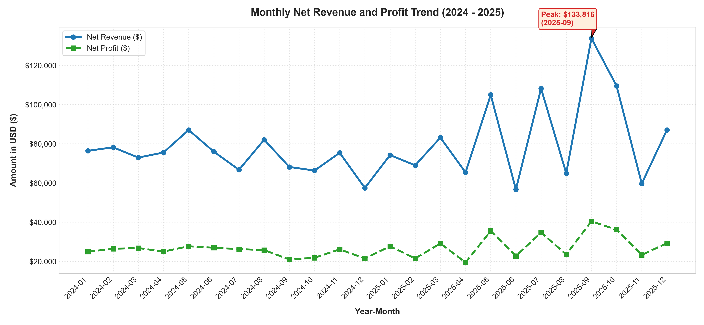
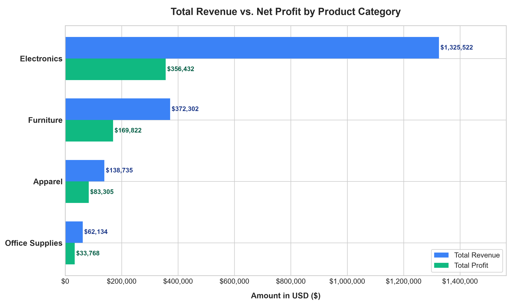
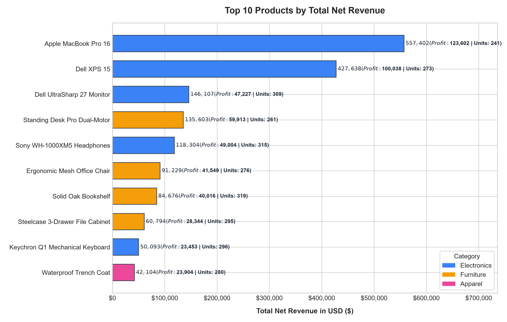
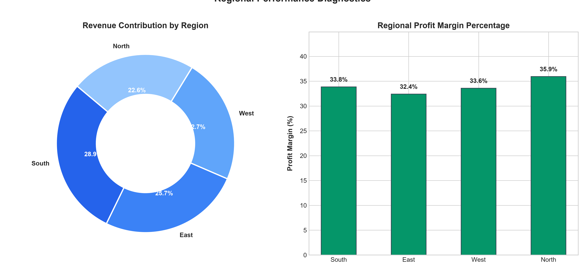
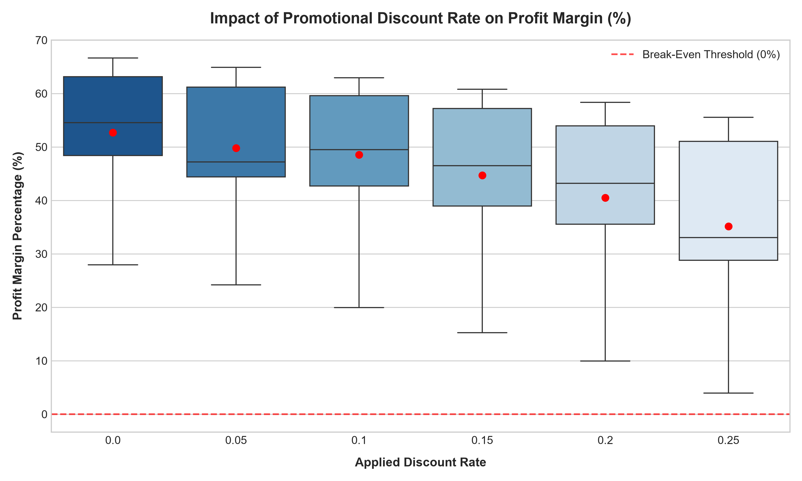

# 🛒 Retail Sales & Profitability Analysis

[](https://www.python.org/)
[](https://pandas.pydata.org/)
[](https://matplotlib.org/)
[](https://seaborn.pydata.org/)
[](https://opensource.org/licenses/MIT)

> An end-to-end Data Analytics portfolio project examining 2,400 multi-category retail transactions across 2024–2025 to evaluate sales trends, product margins, regional dynamics, and promotional discount erosion.

---

## 📌 Table of Contents
- [Project Overview](#-project-overview)
- [Key Business Questions](#-key-business-questions)
- [Dataset Architecture & Quality Audit](#-dataset-architecture--quality-audit)
- [Data Cleaning & Engineering Pipeline](#-data-cleaning--engineering-pipeline)
- [Executive KPI Dashboard](#-executive-kpi-dashboard)
- [Detailed Analytical Findings](#-detailed-analytical-findings)
- [Visualizations](#-visualizations)
- [Strategic Business Recommendations](#-strategic-business-recommendations)
- [Repository Structure](#-repository-structure)
- [Installation & Reproducibility](#-installation--reproducibility)

---

## 📖 Project Overview
Retail organizations must strike a fine balance between top-line revenue growth and bottom-line profitability. Unmonitored discounting, varying product category cost structures, and regional overhead can obscure true net profit. 

This project simulates a real-world enterprise retail dataset across four regions (South, East, West, North) and four main merchandise categories (**Electronics**, **Furniture**, **Apparel**, **Office Supplies**). Using Python, Pandas, and data visualization tools, this project cleans imperfect transactional records, calculates vital financial metrics, and provides senior management with data-driven operational strategies.

---

## 🎯 Key Business Questions
1. **Revenue vs. Profit Realization:** What is the overall net profit margin, and how closely do sales surges correlate with actual earnings?
2. **Category Performance:** Which categories generate the highest revenue, and which yield the strongest margins?
3. **Product Pareto Analysis:** What are the top 10 products driving top-line revenue and bottom-line profits?
4. **Geographic Distribution:** Which sales regions dominate order volume and margin efficiency?
5. **Discount Erosion Impact:** At what threshold does promotional discounting significantly damage gross and net margins?

---

## 📂 Dataset Architecture & Quality Audit

The dataset captures detailed order histories from **2024-01-01** to **2025-12-31**:

| Attribute | Data Type | Description |
| :--- | :--- | :--- |
| `Order_ID` | String | Unique transaction alphanumeric identifier (`ORD-XXXXX`) |
| `Order_Date` | Date/String | Date the purchase was completed (mixed format) |
| `Customer_ID` | String | Unique identifier for customer account |
| `Customer_Segment` | Categorical | Consumer, Corporate, or Home Office |
| `Region` | Categorical | Geographic zone: North, South, East, West |
| `Category` | Categorical | Main merchandise class (Electronics, Furniture, etc.) |
| `Sub_Category` | Categorical | Specific sub-department (Laptops, Monitors, Chairs, etc.) |
| `Product_Name` | String | Full trade name of the purchased item |
| `Unit_Cost` | Float | Manufacturer acquisition/production cost in USD ($) |
| `Unit_Price` | Float | Base retail catalog price in USD ($) |
| `Quantity` | Integer | Units purchased in the transaction (1 to 10) |
| `Discount` | Float | Percentage discount applied (0.00 to 0.25) |
| `Payment_Method` | Categorical | Payment rail (Credit Card, PayPal, Debit Card, Bank Transfer) |

### 🛠️ Initial Data Quality Defects Remediated:
- **Duplicate Records:** 35 duplicate transaction rows detected and dropped.
- **Missing Values:** 
  - `Customer_Segment`: 42 missing values imputed using the mode (`Home Office`).
  - `Payment_Method`: 38 missing values imputed using the mode (`Bank Transfer`).
  - `Discount`: 30 null records imputed with default `0.0` (full retail price).
- **Inconsistent String Formats:** Truncated whitespace in `Category` and standardized letter casing in `Region` (e.g. `'north'` -> `'North'`).
- **Mixed Date Strings:** Parsed multi-format dates (`YYYY-MM-DD` and `DD/MM/YYYY`) into unified timestamps.

---

## ⚙️ Data Cleaning & Engineering Pipeline

The script `src/data_cleaning.py` transforms raw data into an analysis-ready dataset and engineers essential financial KPIs:

$$\text{Gross Sales} = \text{Quantity} \times \text{Unit Price}$$
$$\text{Discount Amount} = \text{Gross Sales} \times \text{Discount}$$
$$\text{Total Net Revenue} = \text{Gross Sales} - \text{Discount Amount}$$
$$\text{Total Cost (COGS)} = \text{Quantity} \times \text{Unit Cost}$$
$$\text{Total Net Profit} = \text{Total Net Revenue} - \text{Total Cost}$$
$$\text{Profit Margin (\%)} = \left(\frac{\text{Total Net Profit}}{\text{Total Net Revenue}}\right) \times 100$$

---

## 📊 Executive KPI Dashboard

Based on 2,400 verified, cleaned transactions:

| Metric | Verified Calculated Value |
| :--- | :--- |
| **Total Cleaned Orders** | **2,400** |
| **Unique Customers** | **448** |
| **Total Units Sold** | **5,816** |
| **Total Net Revenue** | **$1,898,692.70** |
| **Total Cost of Goods (COGS)** | **$1,255,366.00** |
| **Total Net Profit** | **$643,326.70** |
| **Average Order Value (AOV)** | **$791.12** |
| **Blended Net Profit Margin** | **33.88%** |

---

## 📈 Detailed Analytical Findings

### 1. Category Revenue & Profit Breakdown
- **Electronics** accounts for **$1,325,521.70** (69.8% of aggregate revenue) and **$356,431.70** in net profit. However, it operates on the lowest margin (**26.89%**) due to high unit costs.
- **Furniture** is the second largest revenue contributor at **$372,302.50**, generating **$169,822.50** profit with a healthy **45.61%** margin.
- **Apparel** delivered **$138,734.55** in sales and **$83,304.55** in profit, boasting the highest margin efficiency of any category at **60.05%**.
- **Office Supplies** produced **$62,133.95** with a **54.35%** profit margin ($33,767.95 profit).

### 2. Top-Selling Products
1. **Apple MacBook Pro 16:** $557,401.95 Revenue | $123,601.95 Profit | 241 Units
2. **Dell XPS 15:** $427,638.30 Revenue | $100,038.30 Profit | 273 Units
3. **Dell UltraSharp 27 Monitor:** $146,107.20 Revenue | $47,227.20 Profit | 309 Units
4. **Standing Desk Pro Dual-Motor:** $135,603.00 Revenue | $59,913.00 Profit | 261 Units
5. **Sony WH-1000XM5 Headphones:** $118,303.50 Revenue | $49,003.50 Profit | 315 Units

### 3. Geographic & Regional Dynamics
- **South:** Top revenue territory with **$548,525.20** across 624 transactions (33.84% margin).
- **East:** Second largest territory generating **$488,719.05** (596 orders, 32.40% margin).
- **West:** Generated **$431,689.15** (593 orders, 33.58% margin).
- **North:** Most margin-efficient region with **35.92%** profit margin on **$429,759.30** in revenue.

### 4. Promotional Discount Margin Degradation
- Undiscounted orders (0% discount) yield a robust **52.68%** average profit margin across 1,085 transactions.
- A 10% discount compresses the average margin to **48.55%**.
- At a 25% discount, the average margin drops to **35.13%**, and aggregate profit plummets to just **$10,377.75** over 100 sales.

---

## 🖼️ Visualizations

All generated visualizations are archived in `visualizations/`:

| Visualization | Description | Preview |
| :--- | :--- | :--- |
| **01. Monthly Trend** | Revenue vs. Profit trajectory (2024–2025) |  |
| **02. Category Comparison** | Revenue and profit comparison across categories |  |
| **03. Top Products** | Top 10 products by revenue with unit volumes |  |
| **04. Regional Diagnostics** | Revenue share pie chart & regional profit margins |  |
| **05. Discount Impact** | Boxplot showing margin compression vs. discount rate |  |

---

## 💡 Strategic Business Recommendations

1. **Protect Electronics Hardware Margins:**
   - Eliminate 20%+ discounts on premium laptops (MacBook Pro & Dell XPS). Restricting promotional discounts to a maximum of 10% will protect an estimated ~$30k in annual gross profit.
2. **Bundle High-Margin Accessories at Point-of-Sale:**
   - Pair high-margin accessories (Keyboards, Office Supplies, Apparel) with laptop sales. Offering a 5% discount on a laptop only when bundled with an accessory preserves overall cart profitability.
3. **Replicate North Region Operational Best Practices:**
   - The North region leads with a 35.92% margin. Investigate regional pricing, product mix, and logistics efficiencies in the North to apply them across the East and South divisions.
4. **Transition to Loyalty Rebates for Corporate Accounts:**
   - Replace upfront transactional discounts with end-of-quarter volume rebates to encourage higher order frequency without deteriorating per-unit cash margins.

---

## 📁 Repository Structure

```
Retail-Sales-Data-Analysis/
│
├── data/
│   ├── raw_retail_sales.csv         # Raw simulated transactions (with defects)
│   └── cleaned_retail_sales.csv     # Cleaned, standardized & enriched dataset
│
├── notebooks/
│   └── retail_sales_analysis.ipynb  # Interactive Jupyter Notebook with executed outputs
│
├── src/
│   ├── generate_retail_data.py      # Synthetic raw data generator script
│   ├── data_cleaning.py             # Data quality & transformation pipeline
│   ├── exploratory_analysis.py      # KPI computation & chart generation script
│   └── create_retail_notebook.py    # Automated notebook builder
│
├── visualizations/
│   ├── 01_monthly_sales_trend.png
│   ├── 02_sales_and_profit_by_category.png
│   ├── 03_top_selling_products.png
│   ├── 04_regional_performance.png
│   └── 05_discount_vs_profit_margin.png
│
├── requirements.txt                 # Project dependencies
├── .gitignore                       # Git ignore rules
└── README.md                        # Comprehensive portfolio documentation
```

---

## 🚀 Installation & Reproducibility

To run this project locally:

```bash
# 1. Clone the repository
git clone https://github.com/KKSHANMUGAM/Retail-Sales-Data-Analysis.git

# 2. Navigate to project root
cd Retail-Sales-Data-Analysis

# 3. Create and activate a virtual environment
python -m venv venv
# On Windows:
venv\Scripts\activate
# On Mac/Linux:
source venv/bin/activate

# 4. Install required packages
pip install -r requirements.txt

# 5. Execute data cleaning and analysis pipeline
python src/data_cleaning.py
python src/exploratory_analysis.py

# 6. Launch Jupyter Notebook
jupyter notebook notebooks/retail_sales_analysis.ipynb
```

---
**License:** Distributed under the MIT License. Feel free to use and adapt this portfolio template!
